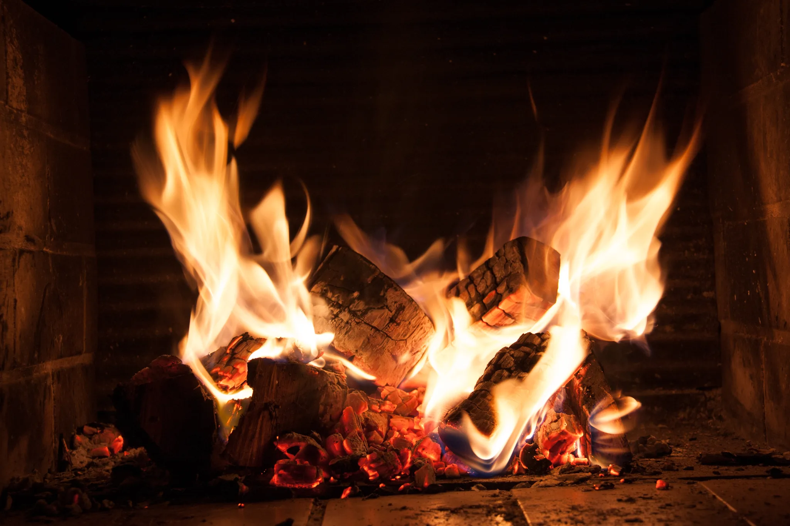

# Fireplace - Theme for Omarchy

Flame reds, ember oranges and warm cream on a near-black brown background, inspired and taken from my fireplace years back and glowing embers. The palette is extracted from my own photos, which are included as backgrounds.

## Install

```bash
omarchy theme install https://github.com/sspaeti/omarchy-fireplace-theme
```

Or `SUPER + ALT + SPACE` → Install → Style → Theme → paste the URL.

## Preview


## Backgrounds
Images where the colors were inspired and taken from.

Main image:

Second close-up shot:


## Obsidian

A matching Obsidian theme with the same palette (dark and light mode): [Fireplace for Obsidian](https://github.com/sspaeti/obsidian_fireplace). Omarchy also generates an `Omarchy` Obsidian theme from `colors.toml` automatically, but the dedicated one has nicer headings, links and tables.

---

*Check also my other Omarchy theme, [Asia Neon](https://github.com/sspaeti/omarchy-asia-neon-theme), and my Obsidian themes [Kanagawa](https://github.com/sspaeti/obsidian_kanagawa), [Kanagawa Paper](https://github.com/sspaeti/obsidian_kanagawa_paper/), [Rosé Pine](https://github.com/sspaeti/obsidian_rose_pine/), [Osaka Jade](https://github.com/sspaeti/obsidian_osaka_jade).*
